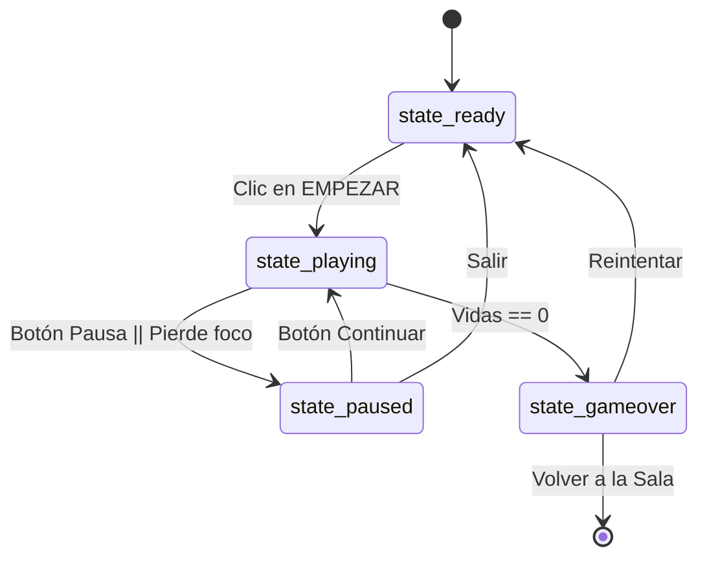

# Módulo 06: Minijuego: Atrapar Comida (Food Drop)
## Máquina de Estados, Física de Captura, Progresión de Dificultad y Combos

---

### 1. Visión General del Minijuego (`obj_minigame_food`)
Ubicado en `rm_minigame_food`. Es un arcade de reflejos rápidos donde diversos alimentos caen desde la parte superior de la pantalla. El jugador controla horizontalmente a Pou con el mouse/touch para atrapar la comida con la boca y esquivar bombas u objetos venenosos.

---

### 2. Máquina de Estados Finitos (FSM)
El flujo completo del juego se gobierna mediante 4 estados discretos:

```gml
state_ready    = 0; // Pantalla de título, instrucciones y botón "EMPEZAR"
state_playing  = 1; // Bucle principal de juego activo
state_paused   = 2; // Modal de pausa con opciones Continuar / Salir
state_gameover = 3; // Resumen final, puntuación, monedas ganadas y nuevo récord
```



---

### 3. Física de Pou y Dimensiones de Jugabilidad
En versiones preliminares, Pou se dibujaba a escala $1.15$ ($575$ px de ancho), ocupando el $80\%$ de la pantalla y haciendo el juego injugable. Se recalibró a proporciones arcade ágiles:
- **Escala de Pou:** `pou_scale = 0.48` (~$170$ px de ancho efectivo).
- **Seguimiento Horizontal:**
  $$X_{t+1} = \text{lerp}(X_t, \text{clamp}(\text{mouse\_x}, 90, 630), 0.35)$$
- **Colisión de Captura en la Boca:**
  La boca se ubica en el intervalo vertical $Y \in [980, 1115]$.
  Para evitar que los alimentos veloces "atraviesen" la boca sin ser detectados (tunneling), se implementó detección continua de segmento entre la posición previa y la actual:
  ```gml
  var _dx = abs(_f.x - pou_x);
  if (_dx <= 85 && _f.y >= 980 && _f.y <= 1115) {
      // ¡Captura exitosa en la boca!
  }
  ```

---

### 4. Spawner Dinámico y Curva de Dificultad Progresiva
Los alimentos no caen a velocidad constante. La dificultad escala matemáticamente en función del puntaje actual (`score_food`):

$$\text{Velocidad de Caída: } V_{\text{fall}} = 4.2 + \min(6.5, \text{score\_food} \times 0.16)$$
$$\text{Intervalo de Aparición: } T_{\text{spawn}} = \max(24, 65 - \text{floor}(\text{score\_food} \times 0.65)) \text{ frames}$$

A partir de 15 puntos, comienzan a aparecer proyectiles trampa (bombas de lodo/herraduras podridas) con una probabilidad de hasta el $25\%$.

---

### 5. Vidas, Combos y Recompensas Económicas
- **Sistema de 4 Vidas:** Representadas por corazones rojos vibrantes en el HUD superior.
- **Recuperación de Vida:** Por cada 15 alimentos atrapados de forma consecutiva (`score_food mod 15 == 0`), el jugador recupera 1 corazón perdido (`snd_moneda`).
- **Sistema de Combos:** Cada alimento capturado sin fallar incrementa el multiplicador de combo ($1\times, 2\times, 3\times...$).
- **Recompensas:**
  - $+1$ Moneda por cada 3 alimentos capturados.
  - Al terminar la partida (`state_gameover`), las monedas se suman inmediatamente a `global.pou_monedas`.
  - La diversión de Pou se eleva proporcionalmente al puntaje obtenido (`global.pou_diversion = min(100, global.pou_diversion + 40)`).
  - Si se supera el récord personal, se guarda en `global.food_drop_highscore`.
